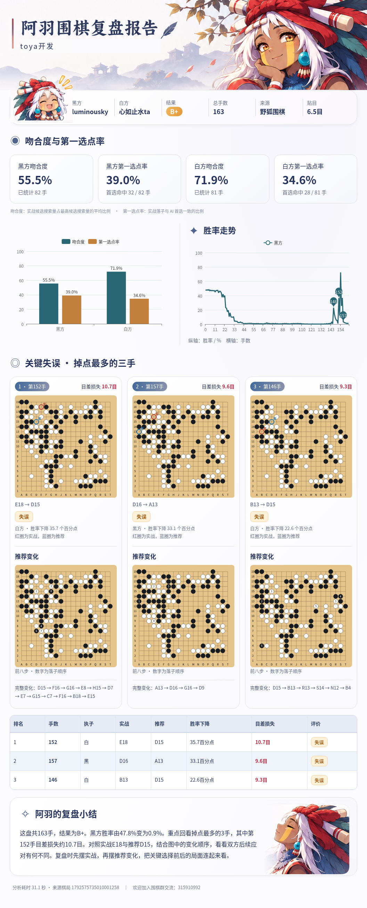

# 阿羽围棋复盘 ♟️

你好呀，我是阿羽！把野狐棋谱发给我，一起看看这盘棋吧～

阿羽围棋复盘是一个 MaiBot 插件，使用**智子围棋云端 KataGo**分析棋谱，生成图文复盘报告。

## 怎么用

在已启用的群里发送 **@阿羽 + 野狐公开棋谱分享链接**。阿羽收到后会先打个招呼，分析完成后发送复盘图。多人提交时会排队处理。

报告包含棋局信息、黑方胜率走势、双方吻合度和第一选点率，以及三处关键失误与推荐变化图。

## 安装

需要 MaiBot、独立 Worker、Chromium 和可使用的智子围棋账户。云端分析会消耗智子账户额度。

插件源码在 `maibot_goreview/`，Worker 在 `goreview/`。具体配置请看 [安装指南](docs/INSTALL.md)，报告内容介绍见 [功能说明](docs/DESIGN.md)。

目前支持野狐公开分享链接。

代码按 [MIT](LICENSE) 发布，第三方依赖及素材保留各自权利。
